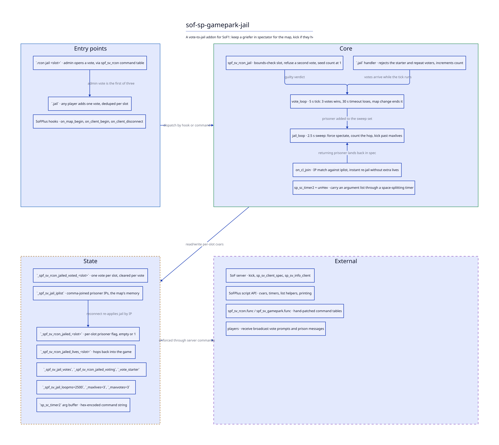

# sof-sp-gamepark-jail

A vote-to-jail addon for Soldier of Fortune: an admin accuses, three players agree, and the accused spends the rest of the map in spectator.

Read it left to right:

- **Jail is spectate-and-watch, not ban.** `spf_sv_gamepark_jail_loop` re-runs every 2.5 s (`_spf_sv_jail_loopms`), and any prisoner found out of spectator is put straight back with `sp_sv_client_spec` while a life is burned. Past `_spf_sv_jail_maxlives` (3) the sweep escalates to `kick`.
- **An admin can only start the vote, not pass it.** `.rcon jail <slot>` bounds-checks the slot, seeds `_spf_sv_jail_votes` at 1 and marks the starter as having voted; players add votes with `.jail`, one per slot via `_spf_sv_rcon_jailed_voted_<slot>`. Three votes inside 30 s is guilty, otherwise the vote fails and everything resets for the next one.
- **Only one vote exists at a time.** `_spf_sv_rcon_jailed_voting` is global, so a second accusation is refused, and the 5 s vote tick also ends itself if `_sp_sv_info_map_count` changes — a vote never survives a map change.
- **Identity is an IP string, not a GUID.** On a verdict the IP is joined into `_spf_sv_jail_iplist`, and `on_client_begin` compares `_sp_sv_info_client_ip` textually against that list to re-jail someone who reconnects. They don't get their lives back, and shared or re-dialled IPs are the obvious edge cases — nothing here is authoritative.
- **Installing it means editing two other addons.** The repo ships only `.func` files; you paste `~command_jail` into `spf_sv_rcon.func` and add `jail` to the command list in `spf_sv_gamepark.func`. The README's two lines are the entire integration contract, and nothing checks that you did it.
- **`sp_sc_timer2` is a workaround you should know about.** `sp_sc_timer` splits its command on spaces, which would shred this script's five-argument vote callback, so the timer is fed hex-encoded arguments and `unHex` rebuilds the real command before `sp_sc_exec_cvar` runs it.

Diagram source: [`docs/system.d2`](docs/system.d2) · renderer: [`scripts/render-diagram.sh`](scripts/render-diagram.sh).
